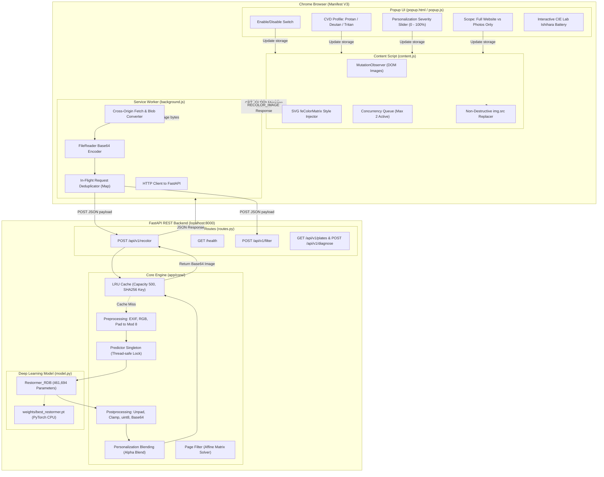

# Dynamic Visual Accessibility Layer (DVAL)
# Current Architecture & Data-Flow Specification

**Document Version**: 1.0.0  
**Target Platform**: Chrome Extension (Manifest V3) & FastAPI / PyTorch Backend  
**System Hardware**: Intel Core i5-1155G7 (4 Cores / 8 Threads, CPU inference)  

---

## 1. System Topology Overview

The Dynamic Visual Accessibility Layer (DVAL) provides personalized real-time recolorization for users with Color Vision Deficiency (CVD):
- **Condition ID 0**: Protanopia (Red-weak / Long-wavelength photopigment deficiency)
- **Condition ID 1**: Deuteranopia (Green-weak / Medium-wavelength photopigment deficiency)
- **Condition ID 2**: Tritanopia (Blue-weak / Short-wavelength photopigment deficiency)



---

## 2. Deep Learning Neural Architecture

The primary production model is **`Restormer_RDB`** (461,694 trainable parameters). It adapts the Restormer image restoration architecture for multi-type CVD recolorization by injecting spatial condition maps and incorporating a Residual Dense Block (RDB) in the latent bottleneck.

```mermaid
flowchart LR
    subgraph Inputs ["Input Processing"]
        RGB["RGB Image (B, 3, H, W)"]
        Cond["Condition ID (B,)"]
        OneHot["One-Hot & Expand (B, 3, H, W)"]
        Cat["Concat (B, 6, H, W)"]
        RGB --> Cat
        Cond --> OneHot --> Cat
    end

    subgraph Encoder ["Hierarchical Encoder"]
        PE["Patch Embedding: Conv2d(6->16, k=3)"]
        Enc1["Level 1: RestormerBlock (16ch, 1 head)"]
        Down1["Downsample: Conv2d(16->8) + PixelUnshuffle(2) -> 32ch"]
        Enc2["Level 2: RestormerBlock (32ch, 2 heads)"]
        Down2["Downsample: Conv2d(32->16) + PixelUnshuffle(2) -> 64ch"]
        Cat --> PE --> Enc1 --> Down1 --> Enc2 --> Down2
    end

    subgraph Bottleneck ["Latent Bottleneck"]
        Latent["Latent RestormerBlock x2 (64ch, 4 heads)"]
        RDB["Residual Dense Block (RDB): 3 dense 3x3 convs + 1x1 fusion"]
        Down2 --> Latent --> RDB
    end

    subgraph Decoder ["Hierarchical Decoder"]
        Up2["Upsample: Conv2d(64->128) + PixelShuffle(2) -> 32ch"]
        Skip2["Concat with Level 2 + Conv2d(64->32, k=1)"]
        Dec2["Level 2 Decoder: RestormerBlock (32ch, 2 heads)"]
        Up1["Upsample: Conv2d(32->64) + PixelShuffle(2) -> 16ch"]
        Skip1["Concat with Level 1 + Conv2d(32->16, k=1)"]
        Dec1["Level 1 Decoder: RestormerBlock (16ch, 1 head)"]

        RDB --> Up2 --> Skip2 --> Dec2 --> Up1 --> Skip1 --> Dec1
        Enc2 -.-> Skip2
        Enc1 -.-> Skip1
    end

    subgraph Output ["Bounded Residual Output"]
        OutProj["Output Projection: Conv2d(16->3, k=3, bias=False)"]
        Tanh["Residual: 0.5 * tanh(OutProj)"]
        AddClamp["clamp(Original_Image + Residual, 0.0, 1.0)"]
        Dec1 --> OutProj --> Tanh
        RGB -.-> AddClamp
        Tanh --> AddClamp
    end
```



### 2.1 Multi-Dconv Head Transposed Attention (MDTA)
Unlike standard spatial self-attention which computes $(HW) \times (HW)$ attention maps, MDTA computes cross-covariance across channel dimensions:
$$\mathbf{Q} = W_d^Q W_p^Q \mathbf{X}, \quad \mathbf{K} = W_d^K W_p^K \mathbf{X}, \quad \mathbf{V} = W_d^V W_p^V \mathbf{X}$$
$$\text{Attention}(\hat{\mathbf{Q}}, \hat{\mathbf{K}}, \hat{\mathbf{V}}) = \hat{\mathbf{V}} \cdot \text{softmax}\left(\frac{\hat{\mathbf{K}}^T \hat{\mathbf{Q}}}{\tau}\right)$$
- Complexity: $\mathcal{O}(C^2 \cdot HW)$ instead of $\mathcal{O}((HW)^2 \cdot C)$.
- Benefit: Linear with respect to image resolution, eliminating out-of-memory errors when processing varied web image sizes.

### 2.2 Gated Depthwise Feed-Forward Network (GDFN)
Combines depthwise separable convolutions with gating:
$$\text{GDFN}(\mathbf{X}) = W_p^2 \left( \text{GELU}(W_d^1 W_p^1 \mathbf{X}) \odot (W_d^2 W_p^2 \mathbf{X}) \right)$$
- Controls information flow across feature channels with element-wise multiplication.

### 2.3 Residual Dense Block (RDB)
Placed inside the 64-channel latent bottleneck:
- Three dense $3 \times 3$ convolutional layers with GELU activations.
- Each layer receives the concatenated features of all preceding layers:
  $$\mathbf{F}_1 = \text{GELU}(\text{Conv}_1(\mathbf{F}_0))$$
  $$\mathbf{F}_2 = \text{GELU}(\text{Conv}_2([\mathbf{F}_0, \mathbf{F}_1]))$$
  $$\mathbf{F}_3 = \text{GELU}(\text{Conv}_3([\mathbf{F}_0, \mathbf{F}_1, \mathbf{F}_2]))$$
  $$\mathbf{F}_{\text{fused}} = \text{Conv}_{\text{fusion}}([\mathbf{F}_0, \mathbf{F}_1, \mathbf{F}_2, \mathbf{F}_3]) + \mathbf{F}_0$$
- Allows contiguous memory and multi-scale feature reuse across receptive fields.

---

## 3. End-to-End Image Processing & Numerical Transport Pipeline

To guarantee identical color reproduction, every step in the transformation pipeline must maintain numerical precision:

```mermaid
sequenceDiagram
    participant Browser as Chrome DOM ()
    participant Worker as Service Worker (background.js)
    participant API as FastAPI (/api/v1/recolor)
    participant Pre as Preprocessing
    participant PyTorch as Model (Restormer_RDB)
    participant Post as Postprocessing & Blend

    Browser->>Worker: src URL (blob, http, or data:)
    Worker->>Worker: fetchImageAsBase64() (FileReader)
    Worker->>API: POST {image_base64, condition_id, severity, return_format}
    API->>API: LRU Cache Lookup (SHA256(bytes) + cond + sev + fmt)
    Note over API: Cache Miss
    API->>Pre: decode_base64_image(image_base64)
    Pre->>Pre: EXIF Orientation Transpose + Convert to RGB (PIL)
    Pre->>Pre: prepare_input_tensor(): uint8 [0, 255] -> float32 [0.0, 1.0]
    Pre->>Pre: Pad spatial dimensions (H, W) to multiples of 8 (replicate)
    Pre->>PyTorch: Input Tensor (1, 3, H_pad, W_pad) + Condition ID
    PyTorch->>PyTorch: append_condition_channels() -> (1, 6, H_pad, W_pad)
    PyTorch->>PyTorch: Forward pass with torch.inference_mode()
    PyTorch->>PyTorch: residual = 0.5 * tanh(proj); output = clamp(x + residual, 0, 1)
    PyTorch->>Post: Output Tensor (1, 3, H_pad, W_pad)
    Post->>Post: unpad_and_clamp_tensor(): Crop to original (H, W), [0, 1] -> uint8 [0, 255]
    Post->>Post: apply_personalization_blend(orig_np, recolored_np, severity)
    Post->>Post: encode_base64_image(): PNG / WebP Base64 Data URL
    Post->>API: Return encoded string
    API->>API: Cache result in LRU Cache
    API->>Worker: JSON Response {status, recolored_base64, inference_time_ms}
    Worker->>Browser: Update img.src with recolored_base64
```

---

## 4. Root Cause Analysis: Model-to-Extension Color Mismatch

Our inspection uncovered three distinct sources of divergence between the trained model and the displayed browser colors:

### 4.1 Coarse Affine Approximation (Scope = "full_page")
In `extension/scripts/content.js`:
- The default configuration is `scope: "full_page"`.
- In `full_page` mode, `content.js` calls `GET_FILTER`, retrieving a 20-element affine color matrix fitted by `page_filter.py` over 125 uniform RGB colors:
  $$\mathbf{Y}_{\text{approx}} = \mathbf{X} \mathbf{W} + \mathbf{b}$$
- This affine matrix is applied via SVG `<feColorMatrix>` to the entire `<html>` element.
- **Problem**: The true Restormer model is deeply non-linear. The linear regression fit has a root-mean-square error ($\text{RMSE} \approx 0.05 - 0.08$), visibly muting contrast and introducing hue distortion compared to the actual model.
- Furthermore, `content.js` **disconnects image processing** while in `full_page` mode. The true neural model was never being executed on images in default mode!

### 4.2 Lossy WebP Compression Noise
In `extension/scripts/background.js`:
- `sendRecolorRequest()` explicitly passed `return_format: "webp"`.
- In `backend/app/core/postprocessing.py`:
  ```python
  pil_img.save(buffer, format="WEBP", quality=90, method=4)
  ```
- **Problem**: Lossy WebP at quality 90 applies YUV 4:2:0 chroma subsampling and lossy block transform quantization. This causes high-frequency color bleeding, edge blurring, and measurable pixel errors ($\Delta E > 2.5$) relative to the float32 model output.

### 4.3 HTML5 `srcset` Shadowing
In modern websites, images frequently include responsive `srcset` attributes:
```html

```
- In `content.js`, the script assigned `img.src = recolored_base64`, but left `srcset` intact.
- **Problem**: The browser's layout engine prioritizes `srcset` candidates over `src`. Consequently, the browser continued rendering the original, uncorrected high-resolution image from `srcset`, completely ignoring the recolored Base64 data in `src`.

---

## 5. Architectural Corrective Actions

To resolve these root causes and guarantee end-to-end color fidelity:
1. **Authoritative Reference Module**: Create `backend/app/core/reference_inference.py` as the single canonical implementation of preprocessing, condition embedding, model evaluation, unpadding, and clamping.
2. **Lossless PNG Transport**: Default `return_format` to `"png"` for pixel-accurate testing and high-fidelity rendering, eliminating WebP chroma subsampling artifacts.
3. **Responsive Image Replacement**: Update `content.js` to store original `srcset` in `data-cvd-orig-srcset` and remove or update `srcset` during recoloring so the recolored `src` renders reliably.
4. **Scope Control Alignment**: Ensure the extension clearly activates per-image Restormer neural inference when image correction is desired, and ensure that both modes maintain documented color behavior.

