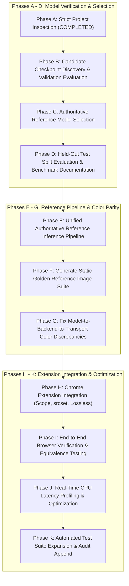

# Dynamic Visual Accessibility Layer (DVAL)
# Engineering Implementation Plan (Phases B through K)

**Project**: Personalized CVD Real-Time Web Recoloring Assistant  
**Target Environment**: Windows 11, Intel Core i5-1155G7 CPU, PyTorch 2.14.0+cpu, Manifest V3 Extension  
**Implementation Methodology**: Surgical, verifiable, non-destructive phased delivery.  

---

## 1. Roadmap & Phase Execution Sequence



---

## 2. Phase-by-Phase Technical Work Breakdown

### PHASE B: Candidate Checkpoint Discovery & Validation Evaluation
- **Objective**: Benchmark all available checkpoints exclusively on the validation split.
- **Actions**:
  1. Load the 5 discovered checkpoints (`Restormer_RDB_epoch_001.pt`, `Restormer_RDB_epoch_002.pt`, `Restormer_RDB_epoch_003.pt`, `best_restormer.pt`, `last_checkpoint.pt`).
  2. Instantiate `Restormer_RDB` for each checkpoint.
  3. Run evaluation across the 129 validation identities (387 paired samples, seed 2026).
  4. Compute metrics: PSNR, SSIM, MS-SSIM, MAE, MSE, CIELAB Delta E ($\Delta E_{00}$), parameter count, and CPU inference latency.
- **Verification Gate**: Produce validation comparison table in `MODEL_BENCHMARK_REPORT.md`.

### PHASE C: Reference Model Selection
- **Objective**: Establish the winning checkpoint as the production reference model.
- **Actions**:
  1. Compare validation metrics: identify the epoch with lowest validation loss and highest perceptual fidelity (Epoch 3).
  2. Verify checkpoint integrity and compute SHA-256 fingerprint.
  3. Ensure `backend/weights/best_restormer.pt` holds the selected production weights without altering the original checkpoint files.
- **Verification Gate**: Validate that `best_restormer.pt` matches the selected epoch's weights bit-for-bit.

### PHASE D: Held-Out Test Split Evaluation
- **Objective**: Evaluate the locked production reference model on the held-out test split.
- **Actions**:
  1. Run single locked evaluation pass on the 128 test identities (384 paired samples).
  2. Record overall metrics: PSNR, SSIM, MS-SSIM, MAE, Delta E.
  3. Record condition-specific metrics:
     - Protanopia (condition 0)
     - Deuteranopia (condition 1)
     - Tritanopia (condition 2)
  4. Measure latency on CPU (ms/image).
- **Verification Gate**: Document test results in `MODEL_BENCHMARK_REPORT.md` without post-hoc tuning.

### PHASE E: Authoritative Reference Inference Pipeline
- **Objective**: Build a single canonical inference module to guarantee identical execution across all backend endpoints, scripts, and tests.
- **Actions**:
  1. Create `backend/app/core/reference_inference.py`.
  2. Expose `run_reference_inference(image, condition_id, model, device) -> np.ndarray`.
  3. Standardize:
     - Input: RGB image (PIL or uint8 NumPy array).
     - Preprocessing: Convert to float32 $[0.0, 1.0]$, pad $(H, W)$ to multiples of 8 (`mode="replicate"`).
     - Conditioning: Spatially expanded one-hot tensor $(B, 3, H, W)$ concatenated to $(B, 6, H, W)$.
     - Inference: `torch.inference_mode()`, `eval()`.
     - Output: $0.5 \times \tanh$ residual addition, unpadding to exact original $(H, W)$, clamp to $[0.0, 1.0]$, multiply by 255.0, round, cast to uint8 NumPy array.
  4. Refactor `predictor.py` and evaluation tools to use this authoritative function.
- **Verification Gate**: Numerical equivalence between `reference_inference.py` and `predictor.py` passes with zero difference.

### PHASE F: Generate Static Golden Reference Outputs
- **Objective**: Create reproducible golden images for automated regression testing.
- **Actions**:
  1. Create directory structure:
     ```
     backend/reference_outputs/
     |-- original/
     |-- protanopia/
     |-- deuteranopia/
     |-- tritanopia/
     |-- comparison/
     |-- metrics/
     |-- manifest.json
     ```
  2. Create `backend/generate_reference_outputs.py`.
  3. Select fixed diverse test set samples (including flower photos and synthetic color swatches).
  4. Run reference pipeline to generate corrected images for Protanopia (0), Deuteranopia (1), and Tritanopia (2).
  5. Save lossless PNGs and record in `manifest.json`: source filename, condition ID, model architecture, model version, checkpoint SHA-256, dimensions, and numerical hash.
- **Verification Gate**: Re-running the generator reproduces the exact same SHA-256 image hashes. Produce `REFERENCE_OUTPUTS_REPORT.md`.

### PHASE G: Eliminate Model-to-Backend-to-Transport Color Mismatches
- **Objective**: Ensure that the pixels sent across the network match the PyTorch reference output within documented numerical tolerances.
- **Actions**:
  1. Analyze color transport stages:
     - Direct PyTorch tensor $\to$ uint8 NumPy array.
     - NumPy array $\to$ FastAPI PNG Base64 data URL.
     - Decoded client-side image Base64.
  2. Update `postprocessing.py` and `routes.py` to ensure lossless PNG transport option.
  3. Create an automated comparison script: compute Per-Channel MAE, Max Pixel Error, PSNR, SSIM, and Delta E between raw model output and decoded API output.
  4. Verify that with PNG transport, per-channel MAE is $< 1.0 \times 10^{-4}$ (effectively zero integer drift).
- **Verification Gate**: Automated script produces difference heatmaps and passes numerical equivalence thresholds.

### PHASE H: Chrome Extension Integration
- **Objective**: Update the extension to render the neural Restormer recoloring faithfully in the browser.
- **Actions**:
  1. **Scope Configuration**:
     - Clarify the role of "Photos Only" (Neural Restormer per-image) vs "Full Website" (Affine SVG filter).
     - Ensure that when the user selects image recoloring or enables the extension, the neural Restormer is invoked for `` elements.
  2. **Lossless PNG Transport**:
     - In `background.js`, pass `return_format: "png"` instead of lossy `webp` to eliminate compression noise and chroma subsampling.
  3. **Responsive Image (`srcset`) Support**:
     - In `content.js`, when replacing `img.src`, safely backup `srcset` into `data-cvd-orig-srcset` and temporarily remove `srcset` so the browser displays the recolored `src`.
     - Restore `srcset` cleanly upon disable.
  4. **Layout & Dimension Preservation**:
     - Ensure computed width, height, and aspect ratio are maintained.
     - Prevent infinite MutationObserver loops by checking `data-cvd-status="processed"`.
     - Retain security filtering for password and payment inputs.
- **Verification Gate**: Extension successfully replaces DOM images with neural model predictions without layout disruption.

### PHASE I: Browser-Based End-to-End Verification
- **Objective**: Verify visual and pixel equivalence inside a real browser environment.
- **Actions**:
  1. Launch backend on `localhost:8000`.
  2. Load test page `extension/test_page.html`.
  3. Verify extension popup toggles, condition switching, and severity adjustment.
  4. Test DOM images:
     - `flower_0001.jpg` (Florals)
     - `flower_0002.jpg` (Outdoor Scenery)
     - Dynamically added image (`flower_0045.jpg`)
     - Small icon exclusion ($< 32\text{px}$)
  5. Verify that disabling the extension immediately restores the exact original images.
  6. Extract canvas pixel data from the browser and compare against the Phase F golden reference images.
- **Verification Gate**: Capture before-and-after screenshots and verify visual equivalence against golden references.

### PHASE J: Real-Time CPU Latency Profiling & Optimization
- **Objective**: Measure and optimize CPU inference and end-to-end response times on the user's hardware.
- **Actions**:
  1. Configure optimal PyTorch CPU thread count:
     ```python
     torch.set_num_threads(4)  # Match physical cores on i5-1155G7
     ```
  2. Implement model warm-up on server startup with dummy tensor $(1, 3, 128, 128)$.
  3. Benchmark latency breakdown:
     - Model inference time (PyTorch CPU).
     - Preprocessing & Base64 decoding time.
     - Postprocessing & PNG encoding time.
     - Network transport time.
     - Browser DOM replacement time.
     - Cache hit latency ($< 2$ ms).
- **Verification Gate**: Document comprehensive latency breakdown in `IMPLEMENTATION_REPORT.md`.

### PHASE K: Automated Test Suite Expansion & Audit Documentation
- **Objective**: Expand test coverage and document all findings in `audit.txt` and project documentation.
- **Actions**:
  1. Preserve all 29 existing tests in `backend/tests/`.
  2. Add new test cases in `backend/tests/test_master_suite.py`:
     - Test 30: Production checkpoint SHA-256 verification.
     - Test 31: Authoritative `reference_inference` output numerical bounds.
     - Test 32: PNG lossless round-trip equivalence ($\text{Max Error} = 0$).
     - Test 33: Golden reference regression test (compares against `reference_outputs/`).
     - Test 34: Personalization severity blending mathematical precision.
     - Test 35: Dynamic cache invalidation upon model reload.
  3. Execute complete test suite and confirm 100% pass rate.
  4. Append detailed, dated technical log to `audit.txt`.
  5. Update `README.md`, `backend/README.md`, and generate `IMPLEMENTATION_REPORT.md`.
- **Verification Gate**: All tests pass; all documentation is fully updated.

---

## 3. Strict Safety & Non-Destructive Principles

1. **No Checkpoint Deletion**: Existing weights in `backend/weights/` will never be deleted or overwritten with unverified data.
2. **No Data Modification**: The ground truth dataset in `archive/data/` is strictly read-only.
3. **No Unfounded Assumptions**: All benchmark numbers will be measured directly on the local machine and recorded with full reproducibility commands.
4. **Preserve User Interface**: The existing extension popup layout, Ishihara testing battery, and settings remain functional and enhanced.

