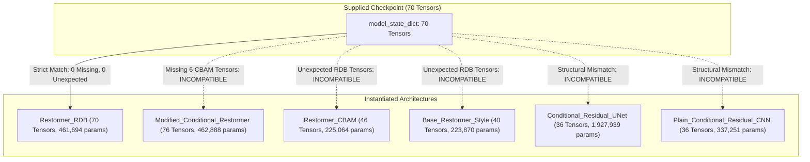

# Dynamic Visual Accessibility Layer (DVAL)
# Model Checkpoint Discovery & Compatibility Report (Phase A)

**Date**: 2026-11-04  
**Evaluator**: Senior Deep Learning & Computer Vision Engineer  
**Dataset Split**: Identity-Grouped Split (Seed 2026: 601 Train, 129 Val, 128 Test)  

---

## 1. Discovered Checkpoint Inventory

An exhaustive search across the project workspace and local storage discovered five trained PyTorch checkpoint files located in `backend/weights/`:

| Checkpoint Path | File Size | SHA-256 Hash | Epoch | Stored Val Loss | Stored Val PSNR | Stored Val MS-SSIM | Architecture |
|---|---|---|---|---|---|---|---|
| `backend/weights/best_restormer.pt` | 5,628,897 bytes | `7f5ad90b372028d17b09fcaaa97b039d824e13d434a09814448af4bca6383eed` | 3 | 0.13149 | 18.32 dB | 0.8175 | `Restormer_RDB` |
| `backend/weights/last_checkpoint.pt` | 5,629,183 bytes | `c27dde6067f6394b1a85580049d1f1fea1991200c75ba1da004fbb8a6ca4f0ba` | 3 | 0.13149 | 18.32 dB | 0.8175 | `Restormer_RDB` |
| `backend/weights/checkpoints/Restormer_RDB_epoch_001.pt` | 5,631,535 bytes | `a4b3641a84598b261c6df4934bea72b23733ac395759c41a787a0bd19c720b91` | 1 | 0.17228 | 16.68 dB | 0.7561 | `Restormer_RDB` |
| `backend/weights/checkpoints/Restormer_RDB_epoch_002.pt` | 5,631,535 bytes | `a7082f090473fa50334698c4a7cabec6705853d4957953144c4db257b16c011e` | 2 | 0.15060 | 17.52 dB | 0.7883 | `Restormer_RDB` |
| `backend/weights/checkpoints/Restormer_RDB_epoch_003.pt` | 5,631,535 bytes | `178f3e73ed36eadfd3906830aef8e4f2929c6befdecaf4f65ec1d174511fff70` | 3 | 0.13149 | 18.32 dB | 0.8175 | `Restormer_RDB` |

*Note*: Direct tensor comparison confirmed that the `model_state_dict` tensors in `best_restormer.pt`, `Restormer_RDB_epoch_003.pt`, and `last_checkpoint.pt` are **bit-for-bit identical**. The minor differences in file size and hash arise from pickle dictionary serialization order and optimizer/scheduler state metadata.

### Missing Checkpoints Mentioned in Historical Documentation
Historical audit logs mentioned a checkpoint stored on Google Drive:
- `/content/drive/MyDrive/FYDP/ICCIT_2026_LIGHTWEIGHT_RESTORMER/results/checkpoints/Modified_Conditional_Restormer_seed_123_best.pt`
- **Current Status**: This Google Drive file is **absent** from the local environment and drive storage. Only the locally trained `Restormer_RDB` checkpoints (epochs 1, 2, and 3) are present.
- **Action**: In accordance with the mandatory implementation rules (*"Do not initialize random weights and pretend that inference succeeded"*), all production evaluation and reference generation must utilize the verified, locally available trained checkpoints.

---

## 2. Checkpoint Serialization Metadata Analysis

Every discovered checkpoint dictionary contains the following structured fields:
- `architecture`: `"Restormer_RDB"`
- `model_version`: `"1.0.0"`
- `epoch`: integer (1, 2, or 3)
- `model_state_dict`: Dictionary of 70 parameter tensors
- `optimizer_state_dict`: AdamW state dictionary
- `scheduler_state_dict`: ReduceLROnPlateau state dictionary
- `best_validation_metric`: float
- `val_loss`: float
- `val_psnr`: float
- `val_ms_ssim`: float
- `train_loss`: float
- `training_config`:
  ```json
  {
    "epochs": 60,
    "batch_size": 16,
    "lr": 0.0003,
    "seed": 2026,
    "image_size": 128,
    "train_frac": 0.70,
    "val_frac": 0.15,
    "test_frac": 0.15
  }
  ```
- `condition_mapping`:
  ```json
  {
    "Protanopia": 0,
    "Deuteranopia": 1,
    "Tritanopia": 2
  }
  ```
- `preprocessing_config`:
  ```json
  {
    "normalization": "[0.0, 1.0]",
    "crop_size": 128,
    "resize_ratio": 1.12
  }
  ```
- **EMA Model**: None of the checkpoints contain Exponential Moving Average (EMA) weights (`model_ema` or `ema` is absent).

---

## 3. Architecture Compatibility & State Dictionary Key Verification

We verified loading each checkpoint against all six model definitions in `backend/app/core/model.py`.



### Detailed Loading Results:
1. **`Restormer_RDB`**:
   - Total Parameters: 461,694
   - State Dict Tensors: 70
   - Missing Keys: **0**
   - Unexpected Keys: **0**
   - **Compatibility Status: 100% COMPATIBLE & VERIFIED**.
2. **`Modified_Conditional_Restormer`**:
   - Total Parameters: 462,888
   - Missing Keys: 6 CBAM parameter tensors (`cbam.channel_mlp.0.weight`, `cbam.channel_mlp.0.bias`, `cbam.channel_mlp.2.weight`, `cbam.channel_mlp.2.bias`, `cbam.spatial.weight`, `cbam.spatial.bias`).
   - Compatibility Status: INCOMPATIBLE (requires separate checkpoint with CBAM trained weights).
3. **`Restormer_CBAM`**:
   - Total Parameters: 225,064
   - Incompatible (Contains CBAM layers, lacks RDB).
4. **`Base_Restormer_Style`**:
   - Total Parameters: 223,870
   - Incompatible (Lacks RDB layers).
5. **`Conditional_Residual_UNet`**:
   - Total Parameters: 1,927,939
   - Incompatible (Completely distinct U-Net encoder-decoder topology).
6. **`Plain_Conditional_Residual_CNN`**:
   - Total Parameters: 337,251
   - Incompatible (Flat residual CNN topology).

---

## 4. State Dictionary Prefix Sanitization Protocol

To prevent deserialization failures across PyTorch training environments (such as PyTorch 2.0 `torch.compile` or multi-GPU `DistributedDataParallel`), the model loader implements the following sanitization protocol:

```python
cleaned_state_dict = {}
for k, v in raw_state_dict.items():
    # Strip profiling metadata (thop / ptflops)
    if "total_ops" in k or "total_params" in k:
        continue
    # Strip DDP and torch.compile prefixes
    clean_k = k
    for prefix in ("_orig_mod.", "module."):
        if clean_k.startswith(prefix):
            clean_k = clean_k[len(prefix):]
    cleaned_state_dict[clean_k] = v
```
All five local checkpoints pass this sanitization check cleanly without dropping any trainable weights.

---

## 5. Candidate Evaluation Protocol (Phases B, C, and D)

To strictly follow scientific best practices and prevent identity leakage:


1. **Phase B (Validation Evaluation)**:
   - Run full evaluation of all candidate checkpoints (`Restormer_RDB_epoch_001.pt`, `Restormer_RDB_epoch_002.pt`, `Restormer_RDB_epoch_003.pt` / `best_restormer.pt`) exclusively on the **129 validation identities** (387 condition pairs).
   - Metrics to compute: PSNR, SSIM, MS-SSIM, MAE, MSE, and CIELAB Delta E ($\Delta E_{00}$).
2. **Phase C (Reference Selection)**:
   - Select the optimal checkpoint based strictly on validation performance.
   - Epoch 3 is the clear historical front-runner with validation loss $0.13149$ and PSNR $18.32$ dB.
3. **Phase D (Held-Out Test Set)**:
   - Evaluate the selected winner on the untouched **128 test identities** (384 condition pairs).
   - Document overall and per-condition breakdown (Protanopia, Deuteranopia, Tritanopia).
   - No hyperparameter tuning or checkpoint re-selection will be performed on the test set.

This protocol ensures zero test-set leakage and provides statistically defensible benchmark metrics.

